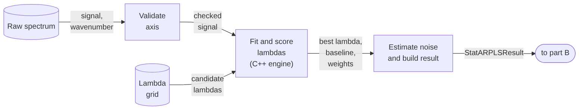
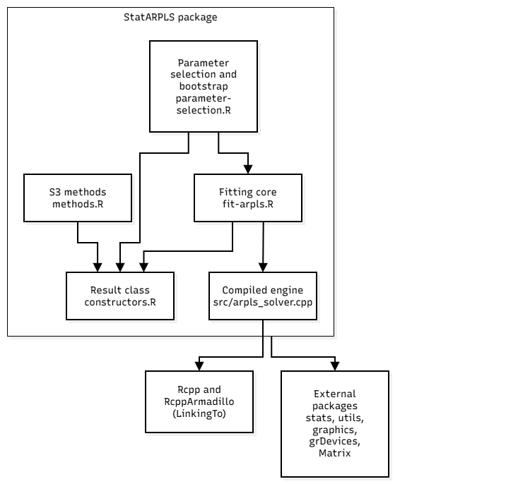
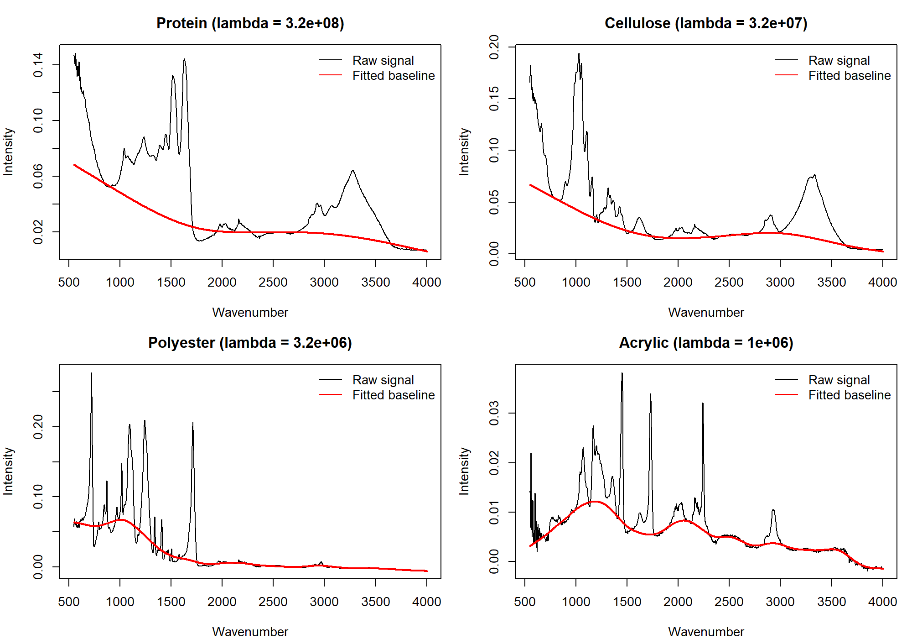
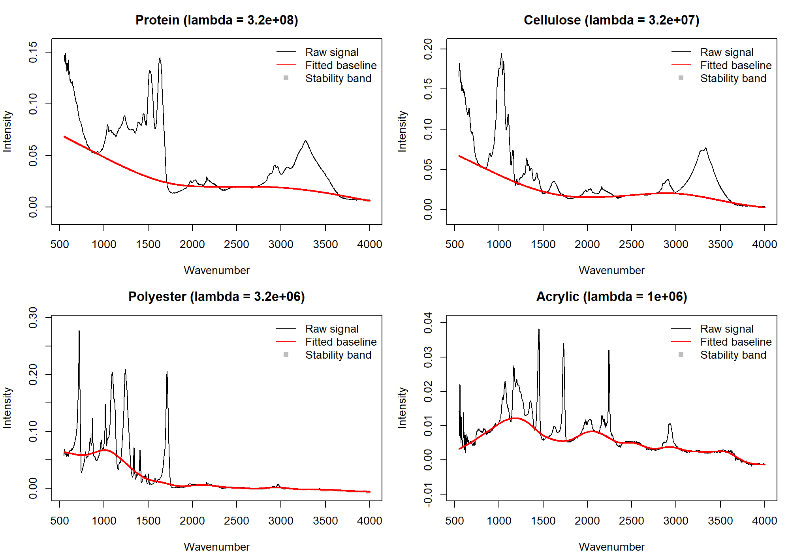

```{r setup, include=FALSE}
knitr::opts_chunk$set(echo = TRUE, message = FALSE, warning = FALSE,
                      fig.align = "center", fig.width = 9, fig.height = 4.3)
library(StatARPLS)

# Simulated spectrum with a known, curved baseline and two peaks
set.seed(501)
wavenumber <- seq(0, 2000, length.out = 500)
true_baseline <- 50 + 0.02 * wavenumber + 30 * sin(wavenumber / 400)
peaks <- 80 * exp(-((wavenumber - 700)^2) / (2 * 25^2)) +
  60 * exp(-((wavenumber - 1300)^2) / (2 * 40^2))
raw_signal <- true_baseline + peaks + rnorm(length(wavenumber), sd = 1.5)
```

<style>
.flow { display: flex; flex-wrap: wrap; align-items: center; justify-content: center; gap: 10px; margin-top: 30px; }
.box  { background: #eef3fb; border: 2px solid #3b6ea5; border-radius: 8px;
        padding: 12px 14px; text-align: center; font-size: 17px; min-width: 150px; }
.box code { font-size: 15px; }
.arrow { font-size: 28px; color: #3b6ea5; }
.good { color: #1b7f3b; font-weight: bold; }
.bad  { color: #b3261e; font-weight: bold; }
h2 { margin-top: 70px; padding-top: 20px; border-top: 2px solid #d5deea; }
h1 { margin-top: 90px; }
body { font-size: 18px; }
@media print { h2 { page-break-before: always; } }
</style>

# Problem and contribution

## The research problem

Spectra (FTIR, Raman, UV-Vis) = **true peaks** on top of an unwanted, slowly varying **baseline**.

- The baseline must be removed before peak detection or quantitative analysis.
- The true baseline is **never observed**, so it has to be estimated.
- The popular statistical method, **ARPLS**, depends on user-chosen parameters:
    - $\lambda$ controls how flexible the baseline is.
    - A poor choice gives a baseline that cuts into peaks, or one that misses the background.
- Existing tools return **one baseline, with no sign of how trustworthy it is**.

## Existing tools and their gaps

| Tool | What it offers | Gap |
|---|---|---|
| `baseline` (R) | AsLS, IRLS, polynomial fitting, others | $\lambda$ chosen by hand; no ARPLS; no uncertainty |
| `hyperSpec` (R) | Spectra container, polynomial and rubberband baselines | No ARPLS or AsLS; manual settings |
| ARPLS-family papers | Variants such as airPLS, asPLS | Standalone algorithms, not R packages |

- Best $\lambda$ is **dataset-specific** and does not transfer (Liland et al., 2010).
- ARPLS can also **absorb broad peaks** into the baseline.

## Core contribution: `StatARPLS`

**What it adds**

- **Automatic $\lambda$**: generalised cross-validation (GCV) with a fast trace estimate.
- **Baseline uncertainty**: moving-block residual bootstrap gives a stability band.
- **Compiled solver** (Rcpp / RcppArmadillo), built from first principles; **not a wrapper**.
- One S3 object, `StatARPLSResult`, with `print`, `summary`, `plot`, `predict`, `compare`.

**What it does not claim**

- Not a new selection criterion: GCV and bootstrap are established tools.
- The contribution is a **tested, documented R implementation that integrates both**.


# Method

## Method: ARPLS in two equations

Weighted penalised least squares (Whittaker smoother), second-difference penalty:

$$\min_z \sum_i w_i (y_i - z_i)^2 + \lambda \sum_i (\Delta^2 z_i)^2 \;\;\Rightarrow\;\; (W + \lambda D^\top D)\,z = W\,y$$

Weights are **re-estimated each iteration** from the residuals $r_i = y_i - z_i$:

$$w_i = \frac{1}{1 + \exp\!\left(2\,\dfrac{r_i - (2s - m)}{s}\right)}$$

where $m$ and $s$ are the mean and standard deviation of the **negative** residuals.

- Points far **above** the baseline (peaks) get weight near 0, so they stop pulling the fit up.
- Iterate until the weights stop changing.

## Method: what we add

**Choosing $\lambda$ by GCV** (weighted residuals, effective degrees of freedom $\mathrm{tr}\,H_\lambda$):

$$\mathrm{GCV}(\lambda) = \frac{n \sum_i w_i r_i^2}{\left(n - \mathrm{tr}\,H_\lambda\right)^2}$$

$\mathrm{tr}\,H_\lambda$ is estimated with **Hutchinson's randomised trace estimator**.

**Uncertainty by moving-block bootstrap** (fixed $\lambda$):

1. Resample **blocks** of residuals at baseline points (keeps serial correlation).
2. Pseudo-signal $y^* = \hat z + e^*$, refit the baseline, repeat $B$ times.
3. Band = the fitted baseline $\pm$ the 2.5% / 97.5% spread of the refits.

# Package design

## Package design: workflow

<div class="flow">
<div class="box"><b>Input</b><br>intensity vector<br>+ wavenumber axis</div>
<div class="arrow">&rarr;</div>
<div class="box"><code>gcv_select_lambda()</code><br>validate axis,<br>choose &lambda;, fit</div>
<div class="arrow">&rarr;</div>
<div class="box"><code>bootstrap_baseline_uncertainty()</code><br>stability band</div>
<div class="arrow">&rarr;</div>
<div class="box"><b>StatARPLSResult</b><br>(S3 object)</div>
<div class="arrow">&rarr;</div>
<div class="box"><code>print</code> <code>summary</code><br><code>plot</code> <code>predict</code><br><code>compare</code></div>
</div>

<br>

- `fit_arpls()` is the single-$\lambda$ fit; the other two share its compiled engine. No circular dependencies between modules.

## Key design choices

- **S3 classes**: simple, idiomatic, easy for users to extend.
- **Rcpp + RcppArmadillo**: the ARPLS solve is the hot loop; a pure-R reference engine is kept to verify it.
- **Base graphics only**: no ggplot2, so no extra dependency footprint.
- **Input checks up front**: finite values, strictly increasing wavenumbers (clear error telling the user to sort), a warning for uneven spacing.
- **Reproducible**: `seed` arguments restore the caller's random-number state on exit.
- **Honest limits built in**: a warning when GCV picks the smallest $\lambda$ in the grid.

## Runtime view: data flow

*What happens when it runs?* Boxes are processing steps (verbs); arrows are data (nouns).

```{r dataflow-a, echo = FALSE, out.width = "100%", eval = file.exists("figures/runtime-dataflow-a.png")}

```

```{r dataflow-b, echo = FALSE, out.width = "100%", eval = file.exists("figures/runtime-dataflow-b.png")}

```

- Part A selects $\lambda$ by GCV and fits the baseline; part B resamples the noise residuals and refits to get the stability band.
- Fixed-$\lambda$ users skip the grid: `fit_arpls()` goes from validation straight to the fit.

## Module view: package diagram

*How is the code organised?* Boxes are files (modules); an arrow means "uses". Arrows are not execution order.

```{r package-diagram, echo = FALSE, out.width = "60%", fig.align = "center", eval = file.exists("figures/module-package.png")}

```

- Dependencies point one way only: methods and selection depend on the result class; selection depends on the fitting core; the core depends on the compiled engine. No cycles.
- The S3 methods depend only on the structure of the result object, not on any fitting code.

# Walkthrough

## Minimal working example

```{r install, eval=FALSE}
# install.packages("devtools")
devtools::install_github("https://github.com/tardagur/StatARPLS")
```

```{r mwe}
library(StatARPLS)
fit  <- gcv_select_lambda(raw_signal, wavenumber, seed = 1)       # automatic lambda
boot <- bootstrap_baseline_uncertainty(fit, B = 100, seed = 2)    # stability band
summary(boot)
```

## The default plot

```{r mwe-plot, fig.height=4.6}
plot(boot)
```

## Core API

| Function | Purpose |
|---|---|
| `gcv_select_lambda()` | Search a $\lambda$ grid, return the best fit |
| `bootstrap_baseline_uncertainty()` | Add a bootstrap stability band (`B = 200` by default) |
| `fit_arpls()` | ARPLS at a fixed $\lambda$ |
| `print()` `summary()` `plot()` | Inspect a result |
| `predict()` | Baseline on a new wavenumber grid |
| `compare()` | Compare two fits |

```{r api-predict}
predict(boot, newdata = c(250, 750, 1250, 1750))
```

# Benchmark and validation

## Benchmark: compiled vs pure-R engine

```{r bench}
bench_lambda <- 1e5; n_inner <- 200
time_engine <- function(engine) {
  as.numeric(system.time(
    for (i in seq_len(n_inner)) engine(raw_signal, bench_lambda, 0.05, 50L, 1e-6)
  )["elapsed"]) / n_inner
}
t_cpp <- time_engine(StatARPLS:::arpls_engine)
t_r   <- time_engine(StatARPLS:::arpls_engine_r)
knitr::kable(data.frame(engine = c("Rcpp (compiled)", "Pure R reference"),
                        seconds_per_fit = signif(c(t_cpp, t_r), 3),
                        speedup = c(signif(t_r / t_cpp, 3), 1)))
```

- Same algorithm, same results (the R engine is the correctness check). Timed on a 500-point spectrum.
- This compares against **my own** pure-R reference, not against other packages.

## Scaling (dense solver)

Measured on my laptop, one spectrum:

| Spectrum length $n$ | Operation | Time |
|---|---|---|
| 1,868 (FTIR) | GCV over 13 $\lambda$ values | about 1.7 s |
| 1,868 (FTIR) | Bootstrap, $B = 100$ | about 16 s |
| 3,092 (Raman) | GCV over 13 $\lambda$ values | about 9.8 s |

- Cost grows steeply with $n$ because the linear solve is **dense**.
- A banded / sparse solve would remove this; it is **future work**, not claimed here.

## Comparison with `baseline` methods

**Simulation with a known baseline** (20 spectra, 1,868 points; smooth curved baseline, 8 narrow peaks, noise SD 0.01). Error = RMSE of the estimated baseline against the true one.

| Method | Median RMSE |
|---|---|
| **StatARPLS (automatic $\lambda$)** | **0.0042** |
| AsLS, $\lambda = 10^7$ | 0.0168 |
| AsLS, $\lambda = 10^5$ | 0.0288 |
| Polynomial fit (degree 4) | 0.0625 |
| IRLS (default) | 0.0744 |
| AsLS, $\lambda = 10^3$ | 0.1065 |

- StatARPLS had the lowest error on **20 of 20** simulated spectra: about **4 times lower** than the best of three hand-picked AsLS settings.
- **AsLS depends on the guess**: on the 16 real FTIR spectra its baseline moved by a median of **30% of the signal range** between $\lambda = 10^3$ and $10^7$.
- On those 16 spectra StatARPLS chose different $\lambda$ for different spectra ($3\times10^5$ to $10^8$).

**What this does and does not show**

- AsLS was **not tuned**: three fixed guesses, not its best $\lambda$. Tuned AsLS may be closer.
- The simulation has narrow peaks and a smooth baseline, where GCV works well. It does not include broad peaks.
- Speed: `baseline` AsLS is **faster per fit** (sparse solver, under 1 ms against about 1.7 s here, where StatARPLS also searches 13 $\lambda$ values). I do not claim to be faster than `baseline`.

## Real data: FTIR (ChemoSpec `SrE.IR`)

```{r real-ftir, eval = requireNamespace("ChemoSpec", quietly = TRUE), fig.height=4.2}
data("SrE.IR", package = "ChemoSpec")
ord <- order(SrE.IR$freq)                       # axis must be increasing
wn  <- SrE.IR$freq[ord]; y <- SrE.IR$data[1, ord]
fit_ir  <- gcv_select_lambda(y, wn, seed = 1)
boot_ir <- bootstrap_baseline_uncertainty(fit_ir, B = 50, seed = 2)
plot(boot_ir)
```

- 16 plant-extract spectra, 1,868 points each. The band is thin because the noise is small.

## Real data: textile ATR-FTIR (Mendeley, CC BY 4.0)

160 spectra, 4000-550 cm<sup>-1</sup>; 4 fibres shown. Transmission converted to absorbance; every 2nd point kept.

| Fibre | Default grid | Larger minimum $\lambda$ | df | Band width |
|---|---|---|---|---|
| Protein (alpaca) | <span class="bad">$\lambda = 100$, follows peaks</span> | $3.2\times10^{8}$ | 4.0 | 0.0018 |
| Cellulose (cotton) | <span class="good">$3.2\times10^{7}$, good</span> | same | 6.1 | 0.0009 |
| Polyester (PET) | <span class="bad">$\lambda = 100$, follows peaks</span> | $3.2\times10^{6}$ | 14.7 | 0.0037 |
| Acrylic (PAN/MA) | $1\times10^{6}$, broad bumps | same | 18.0 | 0.0004 |

- The new warning fired on **exactly** the two failed fits.

Fits with the larger minimum $\lambda$ (baseline under the peaks in all four):

```{r textile-fig, echo=FALSE, eval=file.exists("figures/textile-fits.png"), out.width="60%", fig.align="center"}

```

Bootstrap stability bands on the same fits. Acrylic's band is thin, but its baseline still follows broad bumps: **a thin band does not mean a correct baseline**.

```{r textile-bands, echo=FALSE, eval=file.exists("figures/textile-bands.png"), out.width="60%", fig.align="center"}

```

## Honest findings and limits

- **GCV can under-smooth** reweighted fits: it rewards following the data, so it can pick the smallest $\lambda$. Mitigation: a warning, plus a larger minimum $\lambda$.
- **The band is sampling stability, not total error.** A thin band does not mean the baseline is right (Acrylic is thin but follows broad bumps).
- **Broad peaks can be absorbed** into the baseline, a known ARPLS weakness.
- **Dense solver**: slow beyond a few thousand points.
- Bootstrap pool excludes peak points, so block dependence is approximate across gaps.

# Quality and summary

## Quality assurance

- **92 unit tests** (`testthat`), all passing.
- **`R CMD check`**: 0 errors, 0 warnings, 0 notes.
- Full roxygen documentation, an introduction **vignette**, and S3 methods registered in `NAMESPACE`.
- Code follows the tidyverse style guide; relative paths only.
- Source on GitHub: `github.com/YOUR-USERNAME/StatARPLS` (open source).
- Not yet on CRAN; `pkgdown` site is planned.

## Summary

- **Problem**: ARPLS needs hand-tuned $\lambda$ and gives no uncertainty.
- **`StatARPLS`**: automatic $\lambda$ (GCV) + bootstrap stability band + compiled solver, in one tested S3 package.
- **Evidence**: over 10x faster than the pure-R reference; about 4 times lower baseline error than untuned AsLS in a known-baseline simulation; works on FTIR; a documented failure mode on 2 of 4 textile spectra, now flagged by a warning.
- **Next**: sparse solver (to close the speed gap with `baseline`), comparison against AsLS at its best $\lambda$, a better selection rule than plain GCV.

**Questions?**

<details>
<summary><b>Likely questions (click to open)</b></summary>

- **Why compare with AsLS?** ARPLS descends from AsLS (same penalised least squares, adaptive weights instead of fixed ones); the baseline package has AsLS but no ARPLS.
- **How do you know it is better than `baseline`?** On a simulation with a known baseline, StatARPLS had about 4 times lower RMSE than AsLS at three hand-picked $\lambda$ and won 20 of 20. AsLS was not tuned, so this is the gap against untuned AsLS, not against its best case.
- **Why is it slower than `baseline`?** `baseline` uses a sparse solver; mine is dense, and my timing also includes the search over 13 $\lambda$ values. A sparse solver is the planned fix.
- **Why does the corrected spectrum go negative so often?** ARPLS places the baseline through the middle of the noise, so about half the noise points sit below it; that is not a sign of a poor baseline.
- **Why does GCV fail?** It scores how well the curve fits the data, and a baseline that follows the peaks fits very well.
- **What does the band mean?** How much the baseline moves when the noise is resampled at fixed lambda; not the baseline's own bias.

</details>
